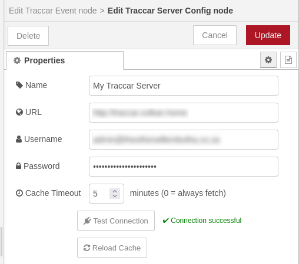
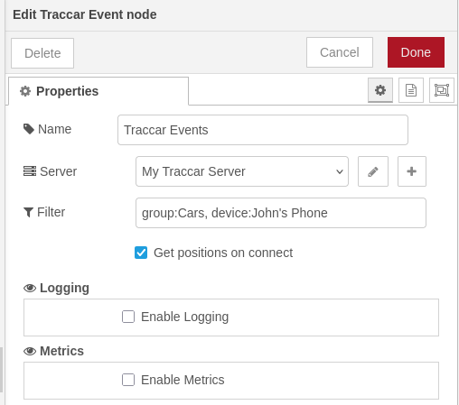
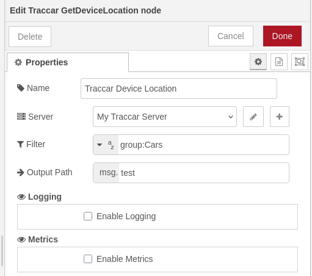

# @theotherwillembotha/node-red-traccar

Node-RED integration for [Traccar](https://www.traccar.org/) - an open-source GPS tracking server. Provides live position event streaming and on-demand location queries for tracked devices and groups.

---

## Prerequisites

- **Node-RED** >= 3.0.0
- **Node.js** >= 18.0.0
- A running **Traccar** server (self-hosted or cloud)
- **`@theotherwillembotha/node-red-plugincore`** - this plugin depends on the plugincore framework. Install it alongside this package:

```bash
npm install @theotherwillembotha/node-red-plugincore
npm install @theotherwillembotha/node-red-traccar
```

> The plugincore package provides shared logging, metrics, and service infrastructure used by all nodes in this plugin.

---

## Nodes

### Traccar Server Config



A shared configuration node that holds the connection details for a Traccar server. All Traccar nodes reference one of these.

**Fields:**

| Field | Description |
|-------|-------------|
| Name | Display label |
| URL | Base URL of the Traccar server, e.g. `http://traccar.example.com` |
| Username | Traccar account email address |
| Password | Traccar account password |
| Cache Timeout | How long (in minutes) to cache device and group data. Default: `5`. Set to `0` to always fetch fresh data. |

**Buttons:**

- **Test Connection** - verifies the URL and credentials against the live server. Reports the number of visible devices on success or a specific error (authentication failure, URL not found, timeout) on failure.
- **Reload Cache** - forces an immediate refresh of the device and group cache without waiting for the timeout to expire. Useful after adding or renaming devices or groups in Traccar.

On deployment the node connects to the Traccar server, loads devices and groups into its internal cache, and opens a persistent WebSocket subscription for live position updates. All Event and Get Device Location nodes that reference this config share the same connection and cache.

---

### Traccar Event



Subscribes to the Traccar server and emits a message for every incoming position update that matches the configured filter.

**Fields:**

| Field | Description |
|-------|-------------|
| Name | Display label |
| Server | The Traccar Server Config node to connect to |
| Filter | Optional filter expression (see [Filter Syntax](#filter-syntax) below). Leave blank to receive all position updates. |
| Get positions on connect | If enabled, fetches the last known position for all matched devices immediately when the WebSocket connects, before waiting for live updates. |

**Output:**

Each matching position update produces one message:

```
msg.payload.position  -  the Traccar position object
```

The position object includes (among other fields):

| Field | Description |
|-------|-------------|
| `latitude` | Latitude in decimal degrees |
| `longitude` | Longitude in decimal degrees |
| `altitude` | Altitude in metres |
| `speed` | Speed in knots |
| `course` | Heading in degrees |
| `valid` | Whether the GPS fix is valid |
| `fixTime` | Timestamp of the GPS fix |
| `serverTime` | Timestamp when the server received the update |
| `deviceId` | Traccar device ID |
| `device` | Enriched device object (name, uniqueId, status, groups, etc.) |
| `attributes` | Device-reported attributes (battery level, ignition, distance, etc.) |

The node status shows **connected** (green dot) when the WebSocket is open, or **disconnected** (red dot) if the connection drops.

---

### Traccar Get Device Location



Fetches the last known position for one or more devices when triggered by an incoming message. Useful for polling workflows or for enriching a message with current device location on demand.

**Fields:**

| Field | Description |
|-------|-------------|
| Name | Display label |
| Server | The Traccar Server Config node to query |
| Filter | A filter expression. Can be set as a literal string or resolved dynamically from `msg`, `flow`, or `global`. See [Filter Syntax](#filter-syntax) below. |
| Output Path | The `msg` property to write results to (e.g. `msg.payload`). Always an array - empty if no devices match. |

**Input:**

Any incoming message triggers a location lookup. The message is forwarded with the results written to the configured output path.

**Output:**

```
msg.<outputPath>  -  array of matching position objects (same structure as above)
```

The array is empty if no devices match the filter. The original message properties are preserved.

---

## Filter Syntax

Both the Traccar Event and Traccar Get Device Location nodes share the same filter syntax. A filter is a comma-separated list of matchers. Each matcher takes the form:

```
<selector>:<pattern>
```

Supported selectors:

| Selector | Matches against |
|----------|----------------|
| `device` | The device name |
| `group` | Any group the device belongs to |

Patterns support `*` as a wildcard (matches any sequence of characters).

**Examples:**

```
device:MyPhone                exact match - device named "MyPhone"
device:Truck*                 prefix wildcard - any device starting with "Truck"
device:*Van*                  substring wildcard - any device whose name contains "Van"
group:Fleet                   all devices in the group named "Fleet"
group:Fleet,device:MyPhone    union - devices in "Fleet" OR the device "MyPhone"
```

**Multiple matchers** are evaluated with OR logic - a position passes if any one matcher matches.

**Group matching is hierarchical.** If device A belongs to group `Child`, and `Child` is a sub-group of `Parent`, then `group:Parent` will also match device A.

**Auto-complete** is available in the editor: type a selector name (e.g. `dev`) and press the auto-complete key to expand it to `device:`, then continue typing a device name to see matching suggestions fetched live from the server.

When the filter field on Traccar Get Device Location is set to `msg`, `flow`, or `global`, the resolved value is used as-is as the filter string.

---

## Caching

Device and group data is cached locally to avoid repeated API calls on every position event. The cache timeout is configured per server (default 5 minutes).

- When the timeout expires, data is re-fetched automatically on the next event.
- Set timeout to `0` to disable caching (always fetch live data).
- Use the **Reload Cache** button on the server config to force an immediate refresh - for example after adding a new device or changing group memberships in Traccar.

---

## References

- [Traccar](https://www.traccar.org/)
- [Traccar API Documentation](https://www.traccar.org/traccar-api/)
- [node-red-plugincore](https://www.npmjs.com/package/@theotherwillembotha/node-red-plugincore)
